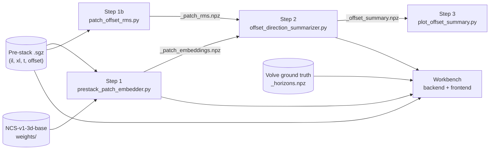

# Seismic Foundation Model for Pre-Stack Data

Applying the [NCS-v1-3d-base](https://huggingface.co/NorskRegnesentralSTI/NCS-v1-3d-base) seismic
foundation model (Norsk Regnesentral; 3D ViT, 768-d latent space, 16×16×16 patches, 224³ crops)
to **pre-stack** seismic, and describing how each patch's embedding moves through latent space as
offset increases.

The repository has two parts:

- **Pipeline**: command-line scripts that embed every common-offset volume, detect live
  (unmuted) offsets, and summarise each patch's offset trajectory.
- **Workbench**: a FastAPI + Vue 3 web app for browsing sections, gathers and the 3D cube,
  running similarity searches in latent space, and comparing results with Volve ground truth.

## Contents

- [How it fits together](#how-it-fits-together)
- [Repository layout](#repository-layout)
- [Dataset](#dataset)
- [Setup](#setup)
- [Workbench](#workbench)
- [Pipeline](#pipeline)
- [Findings on the current dataset](#findings-on-the-current-dataset)
- [Known issues](#known-issues)
- [Testing](#testing)
- [Next steps](#next-steps)
- [Licence and data](#licence-and-data)

## How it fits together



All products are `.npz` files written next to the survey in `data/`, named
`<survey>_<tag>_<product>.npz`. The workbench pairs embeddings and summaries by survey and tag.

## Repository layout

| Path | Contents |
|---|---|
| `embedders/prestack_patch_embedder.py` | Step 1: patch embeddings for every common-offset volume |
| `embedders/patch_offset_rms.py` | Step 1b: per-patch, per-offset RMS for live-offset / mute detection |
| `embedders/offset_direction_summarizer.py` | Step 2: zero-offset vector and 2-D offset basis per patch |
| `visualization/plot_offset_summary.py` | Step 3: PNG figures of the summary (written to `figures/`) |
| `backend/` | FastAPI server: SGZ slicing, latent similarity search (CUDA / MPS / CPU), job runner |
| `backend/scripts/generate_demo_embeddings.py` | Fast signal-derived stand-in embeddings for trying the workbench |
| `backend/scripts/build_reservoir_horizons.py` | Builds the Volve ground-truth horizons file |
| `frontend/` | Vue 3 + TypeScript + Three.js workbench UI |
| `docs/adr/` | Architecture decision records |
| `GLOSSARY.md` | Canonical domain glossary; use its terms in code and docs |
| `weights/`, `data/`, `embeddings/`, `figures/` | Model weights, surveys and derived products (not tracked, except the Volve horizons file) |

## Dataset

`ST0202R08_PZ_PrSDM_CIP_gathers_in_PP_Time.sgz` (Volve, [seismic-zfp](https://github.com/equinor/seismic-zfp)
compressed): **193 inlines × 303 crosslines × 1126 samples (4 ms) × 100 offsets**, −4950 … +4950 m in
100 m steps, with no exact zero offset. On the 16-sample patch grid this is 13 × 19 × 71 patches.

Two acquisition/processing footprints matter for every analysis:

- **Near-offset taper**: the ±50 m bins have about 40 % of the RMS of the ±350–550 m plateau.
- **Stretch mute**: live offsets reach only about 950 m at 350 ms, 3500 m at 2300 ms and 4600 m
  below 3500 ms. Muted patches are zeros and embed alike, so mute-aware analysis (Step 1b) is
  essential.

## Setup

### Prerequisites

- Python 3.12 and [uv](https://docs.astral.sh/uv/)
- Node.js 18+ and npm (workbench frontend)
- The NCS-v1-3d-base weights: download `config.json` and `model.safetensors` from
  [Hugging Face](https://huggingface.co/NorskRegnesentralSTI/NCS-v1-3d-base) into `weights/`
- The survey `.sgz` in `data/`

### Python environment (all platforms)

The backend's `uv` environment contains everything the pipeline needs as well (PyTorch, the
[NCS](https://github.com/NorskRegnesentral/NCS_models) package, seismic-zfp), so one environment
serves both:

```bash
cd backend
uv sync
```

Run pipeline scripts from the repository root with `uv run --project backend python embedders/...`,
or activate `backend/.venv` first.

<details>
<summary>Alternative: standalone pip environment on Windows with CUDA 12.8</summary>

```powershell
python -m venv .venv --system-site-packages   # inherits an existing seismic-zfp / numpy install
.\.venv\Scripts\python.exe -m pip install torch torchvision --index-url https://download.pytorch.org/whl/cu128
.\.venv\Scripts\python.exe -m pip install "git+https://github.com/NorskRegnesentral/NCS_models"
```

The NCS package provides `ViT3DModel`; its heavier inference extras (zarr/xarray/dask) are not
needed, because the tiling and blending are re-implemented in the embedder.
</details>

### Devices

| Hardware | Workbench backend | Pipeline scripts |
|---|---|---|
| NVIDIA GPU | CUDA, chosen automatically | CUDA by default |
| Apple Silicon | MPS, chosen automatically | **pass `--device mps --dtype float16`**; the defaults fall back to CPU and float32 |
| Other | CPU | CPU |

## Workbench

### Run

```bash
# Terminal 1: backend on http://127.0.0.1:8000
cd backend
uv run uvicorn app.main:app --host 127.0.0.1 --port 8000 --reload

# Terminal 2: frontend on http://127.0.0.1:5173 (proxies /api to the backend)
cd frontend
npm install
npm run dev
```

Alternatively, `npm install && npm start` at the repository root starts both with
`concurrently`. Note that this binds the backend to `0.0.0.0`, which makes it reachable from your
network.

No embeddings yet? Generate signal-derived demo embeddings in a few seconds, or launch them from
the **Jobs** dialog:

```bash
cd backend
uv run python scripts/generate_demo_embeddings.py --input ../data/ST0202R08_PZ_PrSDM_CIP_gathers_in_PP_Time.sgz
```

### Configuration

All settings are optional environment variables:

| Variable | Default | Purpose |
|---|---|---|
| `SEISMIC_DATA_DIR` | `<repo>/data` | Surveys (`*.sgz`), embeddings, summaries, horizons; job output goes here |
| `SEISMIC_EMBEDDINGS_DIR` | `<repo>/embeddings` | Additional folder scanned for `.npz` embeddings |
| `SEISMIC_WEIGHTS_DIR` | `<repo>/weights` | NCS-v1-3d-base `config.json` + `model.safetensors` |

After adding files, click **Rescan** in the sidebar (or `POST /api/surveys/rescan`).

### What you can do

**Layouts**: Section Viewer, 3D Cube Viewer, Gather Panel, Split 2H / 2V, or the 3-pane Workbench.

| View | Features |
|---|---|
| **Section Viewer** | Inline, Crossline and Time Slice of the current Common-Offset Volume, with similarity/attribute overlay, Picked Features and reservoir envelope |
| **3D Cube Viewer** | Inline and crossline planes, an optional Time Slice (off by default), a Patch cloud of the active overlay above threshold, gather curtain, reservoir surfaces and picks |
| **Gather Panel** | Stepped pre-stack gathers `(offset, sample)` around the cursor |
| **Sidebar** | Survey and offset, colour maps (seismic default: grayscale), Ground Truth, Latent Exploration, Feature Picking & Refinement, Offset Trajectory |

**Latent Exploration** runs a cosine-similarity search over the embedding set using one of the
fields below, or shows a precomputed attribute (`offset_slope`, `offset_fit_r2`,
`offset_axis_var_1/2/plane`). The summary-based fields need an `_offset_summary.npz`.

| Field | Source |
|---|---|
| `active_offset` | Embedding at the current offset |
| `zero_offset` | Intercept of the offset fit |
| `offset_direction` | Axis 1 of the offset basis |
| `offset_curvature` | Axis 2 of the offset basis |
| `combined_trajectory` | All of the above combined |

**Picked Features** support `single`, `points`, `polyline` and `polygon` geometries on Inline and
Crossline Sections, with **Inclusion (+)** and **Exclusion (−)** refinement. Multi-pick similarity
uses the best match over picks ([ADR 0001](docs/adr/0001-max-match-multi-pick-similarity.md)).

### Controls

| Where | Action | Result |
|---|---|---|
| Section | Click (pick mode) | Add a pick to the active Feature |
| Section | Shift + click, or pick mode off | Move the cursor only |
| Section | Double-click or Enter | Finish a polyline / polygon |
| Section / 3D | Drag a handle | Move a pick |
| Section / 3D | Middle-click a handle | Delete a pick |
| Section / 3D | Click a line | Insert a pick |
| 3D | Drag / scroll | Orbit / zoom |
| 3D | Shift + drag a slice | Move that slice along its axis |
| 3D | Click a patch or slice | Jump the cursor there |

### Jobs

The **Jobs** dialog runs the pipeline on the backend's device and rescans when done:

| Job | Runs | Dialog defaults |
|---|---|---|
| Fast Demo Embeddings | `generate_demo_embeddings.py` | tag `demo` |
| Patch Embedder | `prestack_patch_embedder.py`, optionally followed by the summarizer | offsets `0:100:10`, overlap 0, batch 2 (MPS) / 4 |
| Offset Trajectory Summarizer | `offset_direction_summarizer.py` | — |

> [!WARNING]
> Embedder jobs write to `data/<survey>_ncs3d_patch_embeddings.npz` with `--force`, the same file
> as the full command-line run in Step 1, and they use a quick configuration (10 offsets, no crop
> overlap). Rename a full run you want to keep, for example to tag `ncs3d_ov7`, before launching
> one. See also [Known issues](#known-issues).

## Pipeline

Run the commands from the repository root, either with the backend environment activated or
prefixed with `uv run --project backend`. Add `--device mps --dtype float16` to Step 1 on Apple Silicon.

### Step 1: patch embeddings per offset

```bash
python embedders/prestack_patch_embedder.py \
    --input   data/ST0202R08_PZ_PrSDM_CIP_gathers_in_PP_Time.sgz \
    --weights weights \
    --output  data/ST0202R08_PZ_PrSDM_CIP_gathers_in_PP_Time_ncs3d_patch_embeddings.npz
```

For each common-offset volume `(il, xl, t)`:

1. Zero-pad to a whole 16-sample patch grid and split into 224³ crops overlapping by 7 patches,
   with ramp blending, as in the reference `NCS.inference` pipeline.
2. Normalise by the cube standard deviation and clip at ±3σ. **The std is global across offsets**
   (estimated from 10 random offset volumes, dead traces excluded), so relative amplitude and AVO
   behaviour between offsets is preserved.
3. Run `ViT3DModel` with patch-centre `volume_indices` (required by its LieRE positional encoding),
   drop the CLS token, reorder tokens `(t, il, xl) → (il, xl, t)` and blend overlapping crops.
4. Stream each offset's block into the `.npz`, so memory stays flat in the number of offsets.

| Key | Shape | Meaning |
|---|---|---|
| `embeddings` | `(n_off, n_il, n_xl, n_t, 768)` | Patch embeddings; here `(100, 13, 19, 71, 768)`, float16 by default |
| `offsets`, `offset_index` | `(n_off,)` | Offset header value / index in the SGZ |
| `il_patch_start`, `xl_patch_start`, `t_patch_start` | per axis | 0-based first sample of each patch |
| `inline_center`, `xline_center`, `time_center` | per axis | Header coordinates of patch centres |
| `normalize_std`, `clip_sigma`, `num_overlap_patches`, … | scalars | Run metadata |

Results were checked against direct forward passes (fp32, no overlap: max diff ~1e-5). The output
for 100 offsets is about 2.7 GB in float16.

| Hardware | Settings | 100 offsets |
|---|---|---|
| NVIDIA RTX 5000 Ada | CUDA, float16, overlap 7 (2000 crops) | ~9 min |
| Apple M4 Pro (20-core GPU, 48 GB) | MPS, float16, overlap 7 (2000 crops, 4.5–4.7 crops/s) | 7–7.5 min |
| Apple M4 Pro | MPS, float16, overlap 0 (1200 crops) | ~4.5 min (extrapolated from 20 offsets) |

On MPS, float32 (the `auto` default there) is about 1.3× slower than float16, and the float16
embeddings match float32 to a cosine similarity of ≥ 0.9999.

| Flag | Default | Notes |
|---|---|---|
| `--offsets` | all | `start:stop[:step]` or `i,j,k`, e.g. `0:100:5` |
| `--num-overlap-patches` | `7` | `0` cuts crops per offset from 20 to 12 (about 1.6× faster) |
| `--device` | `cuda` if available, else `cpu` | Use `mps` on Apple Silicon |
| `--dtype` / `--store-dtype` | `auto` / `float16` | Compute and storage precision; `auto` is float16 on CUDA only, so pass `float16` on MPS |
| `--normalize-std` | estimated | Reuse a previous run's statistics |
| `--force` | off | Overwrite an existing output |

### Step 1b: live-offset detection

```bash
python embedders/patch_offset_rms.py --input data/ST0202R08_PZ_PrSDM_CIP_gathers_in_PP_Time.sgz
# -> data/<survey>_patch_rms.npz: rms (n_off, n_il, n_xl, n_t) on the patch grid (~50 s on an M4 Pro)
```

### Step 2: zero-offset vector and 2-D offset basis

```bash
python embedders/offset_direction_summarizer.py \
    --input data/ST0202R08_PZ_PrSDM_CIP_gathers_in_PP_Time_ncs3d_patch_embeddings.npz \
    --rms   data/ST0202R08_PZ_PrSDM_CIP_gathers_in_PP_Time_patch_rms.npz
# -> data/<survey>_ncs3d_offset_summary.npz
```

For every patch, the embeddings `e_h` (one per offset `h`) trace a trajectory in 768-d latent space,
described by a point and an orthonormal 2-D basis. Offsets with `|h| < --min-offset` (300 m, the
near-offset taper) are never used in the fit. With `--rms`, an offset counts as **live** for a patch
only when its RMS is at least `--live-threshold` (0.2) × the patch's maximum RMS over offsets; the
fit, PCA and variance statistics use live offsets only.

> [!IMPORTANT]
> Always pass `--rms`. Without it every offset ≥ 300 m is used, and on this dataset axis 1 becomes
> largely "the direction from data to no-data".

| Key | Shape | Meaning |
|---|---|---|
| `zero_offset` | `(…, 768)` | **Intercept** of the fit below: the trajectory extrapolated to `\|h\| = 0` from live, untapered offsets (`--zero-offset nearest` uses the mean of the tapered ±50 m embeddings instead) |
| `offset_direction` | `(…, 768)` | **Axis 1**: unit slope `b/‖b‖` of the least-squares fit `e ≈ a + b·\|h\|` over live offsets; points the way the embedding moves as offset grows |
| `offset_curvature` | `(…, 768)` | **Axis 2**: top principal component of the residual variation after removing axis 1, oriented to correlate positively with centred `\|h\|²` |
| `offset_coords` | `(n_off, …, 2)` | Coordinates of `e_h − zero_offset` in the basis, for all offsets |
| `offset_slope` | `(…)` | `‖b‖`, latent displacement per metre of offset |
| `offset_fit_r2` | `(…)` | Fraction of across-offset variance explained by the linear fit |
| `offset_axis_var` | `(…, 2)` | Fraction of variance along each axis; the sum is the plane's share |
| `live_offsets`, `n_live_offsets` | `(n_off, …)`, `(…)` | Live mask and count; patches with fewer than `--min-live` (4) live offsets are zero |

Other flags: `--zero-offset intercept|nearest`, `--store-dtype`, `--chunk`, `--force`. Runtime on the
full 100-offset embeddings: about 30 s on an M4 Pro.

### Step 3: figures

```bash
python visualization/plot_offset_summary.py \
    --input data/ST0202R08_PZ_PrSDM_CIP_gathers_in_PP_Time_ncs3d_offset_summary.npz \
    [--ref il,xl,t] [--clusters 6] [--only GROUP ...]
```

Writes to `figures/`: scalar diagnostic slices in all three orientations (`scalars_*`), cosine
similarity to a reference patch for each 768-d field (`cosine_*`), PCA→RGB overviews (`pca_rgb_*`),
spherical k-means classes of `offset_direction` with mean trajectories (`clusters_*`),
neighbour-cosine coherence (`coherence_*`) and per-patch trajectories around the reference
(`trajectories_*`). Muted offsets are drawn faint in trajectory plots.

### Volve ground truth

```bash
cd backend
uv run --with pyarrow python scripts/build_reservoir_horizons.py \
    --survey ../data/ST0202R08_PZ_PrSDM_CIP_gathers_in_PP_Time.sgz
```

Downloads open Volve data (Top Hugin TWT horizon, well picks, the Eclipse corner-point grid with
ACTNUM) into `data/volve_reservoir/`, maps it onto the survey's inline/crossline grid via the
CDP_X/CDP_Y headers, converts the reservoir model from depth to PP time, and writes
`data/<survey>_horizons.npz`. The backend serves it at `GET /api/surveys/{id}/horizons`; the UI shows
it with the **Ground Truth / Reservoir** toggles.

## Findings on the current dataset

Mute-aware fit (`--rms`, threshold 0.2, offsets ≥ 300 m): median 36 live offsets per patch, 4 % of
patches unfittable.

| | q10 | median | q90 |
|---|---|---|---|
| Linear-in-`\|h\|` fit R² | 0.20 | 0.32 | 0.49 |
| Variance along axis 1 | 0.24 | 0.37 | 0.55 |
| Variance along axis 2 | 0.13 | 0.20 | 0.31 |
| Variance in the 2-D plane | 0.45 | **0.59** | 0.74 |

Fitting over *all* offsets with the ±50 m mean as origin gives a median plane variance of 0.72
(axis 1: 0.54); the difference is the trivial variance between live data and muted zeros, which the
mute-aware fit removes.

- **Shape:** with the intercept as origin, trajectories run out along axis 1 with a bowl on axis 2
  (about −2 at ~2000 m), bending back towards the mute. Spherical k-means on `offset_direction`
  separates *directions* (centroid cosines ≤ 0.5) that share this common *shape*; the classes form
  layer-conformable bands in section and coherent areas in map view.
- **Amplitude:** the tapered ±50 m embedding lies about 0.7 × the axis-1 span from the intercept,
  mostly *along* axis 1 (median cosine 0.69). The model reads low-amplitude near bins much like
  low-amplitude far bins, so axis 1 carries a strong amplitude component.
- **Symmetry:** fitting positive and negative offsets separately gives directions with median cosine
  0.94 (q10 0.60), so regressing on `|h|` is a reasonable default.

## Known issues

| Issue | Where | Effect |
|---|---|---|
| Summarizer jobs never pass `--rms` | `backend/app/jobs.py` | Summaries built from the UI are not mute-aware (see Step 2); run Step 2 from the command line for analysis |
| "Exclude ±50 m near-zero offsets" passes `--exclude-zero-offset`, which the summarizer does not accept | `backend/app/jobs.py` | The summarizer job fails when this box is ticked |
| The Survey Preprocessor job expects `preprocessing/preprocess.py`, which is not in the repository | `backend/app/config.py` | `POST /api/jobs/preprocess` cannot succeed |
| Embedder jobs overwrite the `ncs3d` embeddings | `backend/app/jobs.py` | See the warning under [Jobs](#jobs) |

## Testing

```bash
cd backend
uv run pytest
```

The API tests read real files: point `SEISMIC_DATA_DIR` at a folder containing the survey and its
embeddings (demo embeddings are enough), and set `SEISMIC_WEIGHTS_DIR` / `SEISMIC_EMBEDDINGS_DIR` if
they are not in the default locations. The frontend has no test runner; check it with
`npm run build` (type check + production build).

## Next steps

- Tighten `--live-threshold` (0.3–0.5) to keep the mute ramp itself out of the fit; a few classes
  still show large axis-1 excursions at the mute edge.
- Separate positive and negative offset bases for asymmetric patches.
- Per-offset normalisation (instead of a global std) to separate waveform changes from AVO.
- Cluster on trajectory *shape* (`offset_coords` over live offsets) rather than direction.
- Map `offset_coords`, `offset_slope` and `offset_axis_var` to find where offset behaviour is
  strong, linear or curved.

## Licence and data

Code: [MIT](LICENSE). Model: NCS-v1-3d-base by Norsk Regnesentral, distributed under its own
licence on Hugging Face. Volve data: Equinor's Volve data licence.
